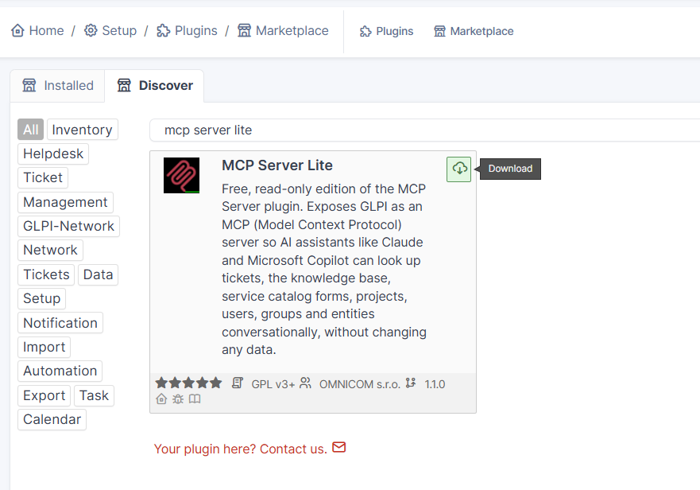
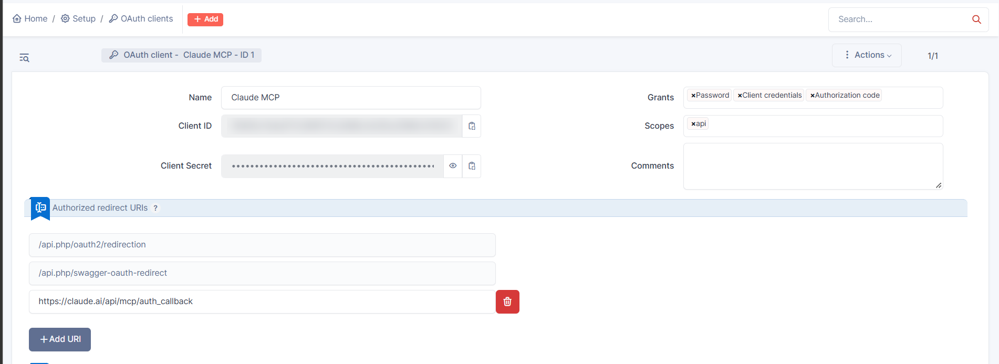
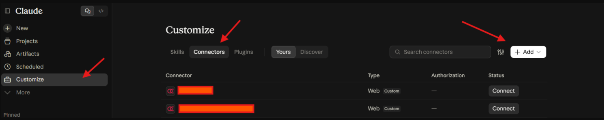

# Connect Claude to GLPI with MCP Server Lite

MCP Server Lite 1.1.0 | GLPI 11.0.11 or later | OMNICOM

**You need:** GLPI 11.0.11 or later, reachable over HTTPS from the internet, and a Super-Admin account. Self-hosted GLPI needs a GLPI Network registration key (**Setup > General > GLPI Network**) to use the Marketplace.

## Step 1: Activate the plugin

1. In GLPI, go to **Setup > Plugins > Marketplace**, tab **Discover**.
2. Search for `MCP Server Lite`, then click **Download**, **Install** and **Enable**.

*GLPI, Setup > Plugins > Marketplace > Discover, Download button*

No GLPI Network key? Install the plugin manually from the zip on [Releases](https://github.com/OMNICOM-Digital/mcpserver-lite/releases/latest) instead, see [Installation](../README.md#installation).

## Step 2: Create an OAuth client in GLPI

1. Go to **Setup > General > OAuth clients** and click **+ Add**.
2. Fill in:

| Field | Value |
| --- | --- |
| Name | `Claude MCP` |
| Grants | All of them (Authorization code, Client credentials, Password) |
| Scopes | `api` |
| Authorized redirect URIs | `https://claude.ai/api/mcp/auth_callback` |

3. Save, then copy the **Client ID** and **Client Secret**.

*GLPI, Setup > General > OAuth clients, client for Claude*

## Step 3: Add the connector in Claude

1. In Claude, go to **Customize > Connectors**, click **+ Add** and choose **Add custom connector**.

*Claude, Customize > Connectors > + Add*

2. Fill in the first screen and click **Continue**:

| Field | Value |
| --- | --- |
| Name | GLPI |
| MCP server URL | `https://<your-glpi>/plugins/mcpserverlite/front/mcp.php` |

3. On the second screen, check these settings (Claude usually preselects them and marks them *Detected*):

| Section | Setting |
| --- | --- |
| Authentication | **Sign in now** |
| OAuth client | **Use your own OAuth client** |
| OAuth client ID | Client ID from Step 2 |
| OAuth client secret | Client Secret from Step 2 |

> **Note:** Claude marks the client secret as optional, but GLPI OAuth clients are always confidential. The secret is required.

If Claude asks for a transport, choose **Streamable HTTP**.

4. Leave *Request headers* and *Advanced* empty and click **Add**.
5. On the connector page, click **Connect**.
6. GLPI opens its sign-in page. Sign in with your own GLPI account, then click **Accept** on the consent screen.
7. Back in Claude, the connector page shows that it is connected. Under **Tool permissions** you will see the 33 read-only tools and can choose, for each one, whether Claude may use it automatically, must ask first, or is blocked.

Each user signs in with their own GLPI account and sees only what their GLPI rights allow.

## If it does not work

| Problem | Fix |
| --- | --- |
| `invalid_client` | Client secret missing or pasted with spaces |
| Consent works, then the connection fails | Enable all grant types on the OAuth client |
| Tools missing after a plugin update | Disconnect and reconnect the connector |

---

*This guide covers MCP Server Lite 1.1.0 on GLPI 11.0.11 to 11.9.x. Architecture and full setup notes: [technical-overview.md](technical-overview.md). Other AI clients: [Connect Microsoft Copilot Studio](connect-copilot-studio.md).*
