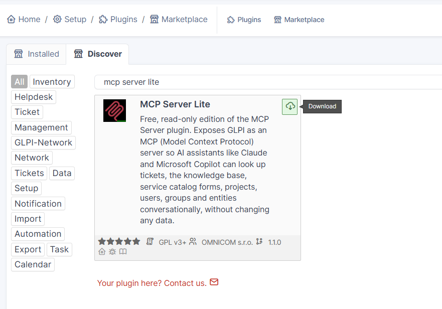
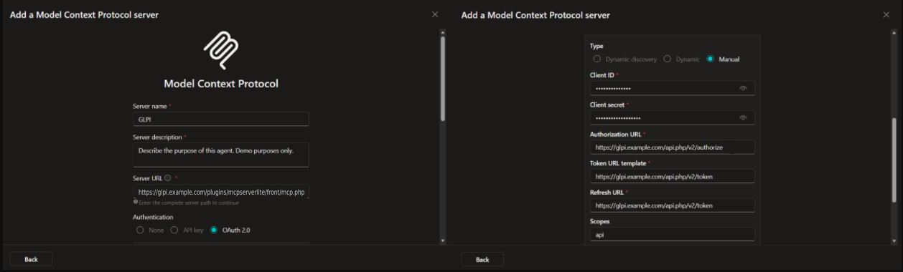

# Connect Microsoft Copilot Studio to GLPI with MCP Server Lite

MCP Server Lite 1.1.0 | GLPI 11.0.11 or later | OMNICOM

**You need:** GLPI 11.0.11 or later, reachable over HTTPS from the internet, and a Super-Admin account. Self-hosted GLPI needs a GLPI Network registration key (**Setup > General > GLPI Network**) to use the Marketplace. In Copilot Studio, maker rights on the agent.

## Step 1: Activate the plugin

1. In GLPI, go to **Setup > Plugins > Marketplace**, tab **Discover**.
2. Search for `MCP Server Lite`, then click **Download**, **Install** and **Enable**.

*GLPI, Setup > Plugins > Marketplace > Discover, Download button*

No GLPI Network key? Install the plugin manually from the zip on [Releases](https://github.com/OMNICOM-Digital/mcpserver-lite/releases/latest) instead, see [Installation](../README.md#installation).

## Step 2: Create an OAuth client in GLPI

1. Go to **Setup > General > OAuth clients** and click **+ Add**.
2. Fill in:

| Field | Value |
| --- | --- |
| Name | `Copilot Studio` |
| Grants | All of them (Authorization code, Client credentials, Password) |
| Scopes | `api` |
| Authorized redirect URIs | `https://global.consent.azure-apim.net/redirect` |

The redirect URI above is only a placeholder. You replace it with the real callback URL in Step 3.

3. Save, then copy the **Client ID** and **Client Secret**.

## Step 3: Add the MCP tool in Copilot Studio

1. In your agent, check that **Settings > Generative AI** is set to **Generative**.
2. Go to **Tools > Add a tool > New tool > Model Context Protocol** and fill in:

| Field | Value |
| --- | --- |
| Server name | `GLPI` |
| Server description | Read-only access to GLPI tickets, knowledge base and projects |
| Server URL | `https://<your-glpi>/plugins/mcpserverlite/front/mcp.php` |
| Authentication | **OAuth 2.0 > Manual** |
| Client ID / Client secret | From Step 2 |
| Authorization URL | `https://<your-glpi>/api.php/v2/authorize` |
| Token URL template / Refresh URL | `https://<your-glpi>/api.php/v2/token` |
| Scopes | `api` |

*Copilot Studio, Add a Model Context Protocol server*

3. Click **Create** and copy the **callback URL** Copilot Studio shows.
4. In GLPI, open the OAuth client from Step 2, replace the placeholder redirect URI with that exact callback URL, and save.
5. Back in Copilot Studio, click **Create a new connection**, sign in to GLPI, then **Add to agent**.

Each user signs in with their own GLPI account and sees only what their GLPI rights allow.

## If it does not work

| Problem | Fix |
| --- | --- |
| No tools show up | Redirect URI in GLPI does not exactly match the callback URL (Step 3.4) |
| Nothing happens when adding the tool | Generative orchestration is off (Step 3.1) |
| `invalid_client` | Client secret missing or pasted with spaces |

---

*This guide covers MCP Server Lite 1.1.0 on GLPI 11.0.11 to 11.9.x. Architecture and full setup notes: [technical-overview.md](technical-overview.md). Other AI clients: [Connect Claude](connect-claude.md).*
